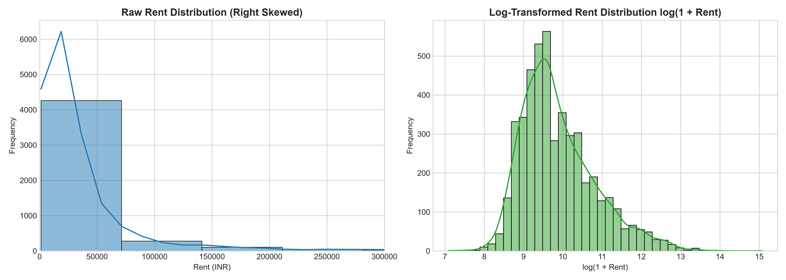
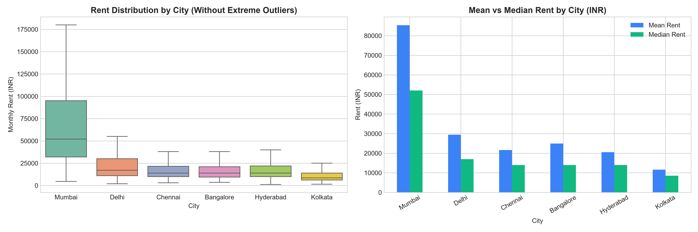
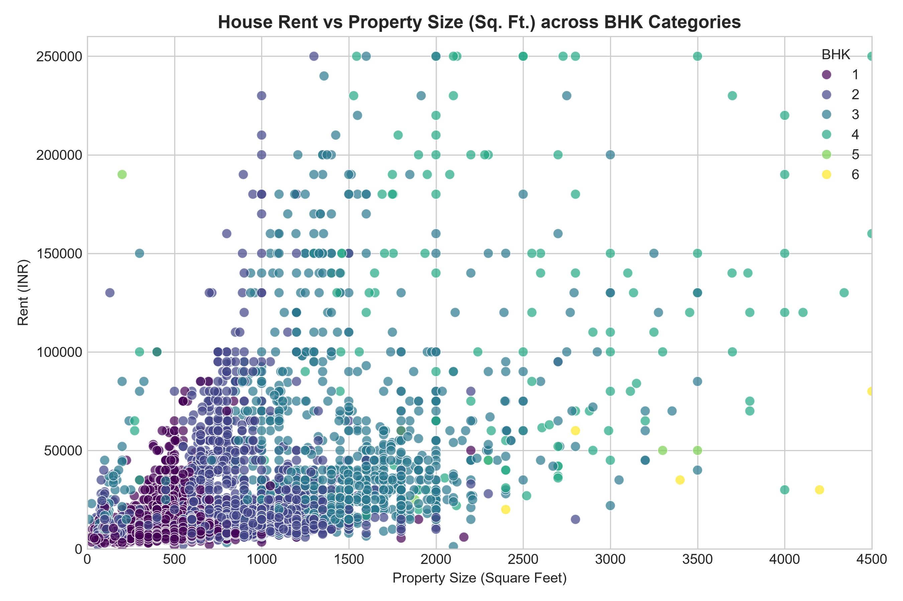
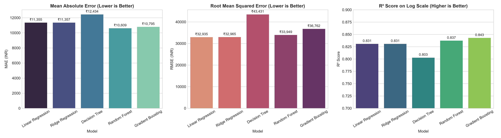
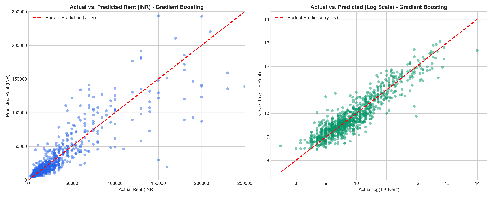
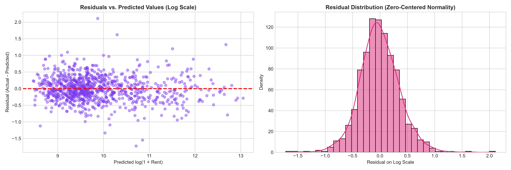
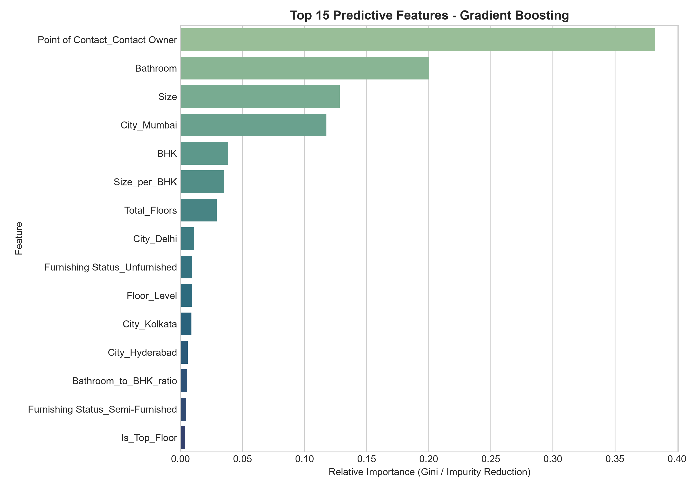

# ASSIGNMENT 2: MACHINE LEARNING APPLICATION
## TOPIC: HOUSE RENT PREDICTION AND COMPARATIVE MACHINE LEARNING ANALYSIS

---

| **Attribute** | **Assignment Details** |
| :--- | :--- |
| **Course** | Machine Learning & Applied AI |
| **Assignment** | Assignment 2 – Machine Learning Application |
| **Topic** | Build and Analyze a Machine Learning Model: House Rent Prediction |
| **Dataset** | Comprehensive Indian Metropolitan House Rent Dataset (4,746 Listings) |
| **Algorithms** | Linear Regression, Ridge Regression, Decision Tree, Random Forest, Gradient Boosting |
| **Deployment** | Interactive Streamlit Web Application (`app.py`) |
| **Submission Date** | On or before 07-10-2026 |

---

## EXECUTIVE SUMMARY / ABSTRACT

Accurate estimation of residential rental prices is a pivotal machine learning application with substantial socio-economic impact. Rental real estate markets are notoriously heterogeneous, characterized by acute spatial dependencies, non-linear feature interactions, and heavy right-skewed price distributions. In this study, an end-to-end Machine Learning regression framework was developed to predict monthly residential rents across six major metropolitan hubs in India (Mumbai, Bangalore, Chennai, Hyderabad, Delhi, and Kolkata). 

The raw dataset comprising 4,746 listings and 12 baseline attributes was cleaned, preprocessed, and enriched through domain-driven feature engineering, including floor hierarchy decomposition and spatial density ratios. To mitigate extreme heteroscedasticity and outlier dominance, a natural logarithmic target transformation was applied. Five distinct machine learning algorithms representing diverse inductive paradigms were trained and evaluated via 5-fold cross-validation: Multiple Linear Regression (OLS), Ridge Regression ($L_2$ regularization), Decision Tree Regressor (CART), Random Forest Regressor (Bagging Ensemble), and Gradient Boosting Regressor (Sequential Boosting). 

The empirical benchmark revealed that ensemble architectures substantially outperformed linear baselines. The **Gradient Boosting Regressor** achieved superior generalization with a test-set **Mean Absolute Error (MAE) of ₹10,795**, a **Mean Absolute Percentage Error (MAPE) of 29.46%**, and a log-scale **$R^2$ score of 0.8428** (5-Fold CV $R^2 = 0.8255 \pm 0.0102$). Feature importance analysis confirmed that property size (sq. ft.), metropolitan city tier (specifically Mumbai's spatial premium), and bathroom count constitute the primary drivers of rental valuation. Finally, the optimized pipeline was deployed as an interactive, production-ready **Streamlit web application** enabling real-time valuation, confidence interval estimation, and comparative market diagnostics.

---

## 1. PROBLEM STATEMENT & REAL-WORLD MOTIVATION

### 1.1 Problem Statement
Given a set of structured physical, spatial, and contractual property characteristics $\mathbf{x} \in \mathbb{R}^d$, the objective is to learn a predictive mapping function $f: \mathbf{x} \to y$, where $y \in \mathbb{R}^+$ denotes the monthly house rent in Indian Rupees (INR). This constitutes a continuous multi-variable supervised regression problem.

### 1.2 Real-World Motivation
The residential rental market across urban India has witnessed exponential growth due to rapid urbanization, employment migration to tech corridors, and changing demographics. However, the market suffers from:
1. **Information Asymmetry:** Tenants often overpay due to opaque rental pricing models dictated by intermediaries.
2. **Sub-optimal Landlord Pricing:** Property owners frequently experience high vacancy rates due to unrealistic rent expectations, or suffer revenue loss from under-pricing.
3. **Extreme Geographic Disparities:** A 2-BHK apartment in Mumbai commands vastly different rental economics compared to an identical unit in Kolkata or Hyderabad due to local land availability constraints.

Developing an algorithmic pricing system provides fair-market transparency, stabilizes rental yield expectations, and automates real estate valuation.

---

## 2. DATASET OVERVIEW & EXPLORATORY DATA ANALYSIS (EDA)

### 2.1 Dataset Description
The dataset comprises **4,746 validated rental listings** collected across six tier-1 metropolitan cities in India: Mumbai, Bangalore, Chennai, Hyderabad, Delhi, and Kolkata.

| Column Name | Data Type | Description | Domain Range / Categories |
| :--- | :--- | :--- | :--- |
| `Posted On` | String (Date) | Date listing was published | 2022-04-13 to 2022-07-11 |
| `BHK` | Integer | Bedrooms, Hall, Kitchen count | 1 to 6 |
| `Rent` | Integer (Target) | Monthly rent in Indian Rupees (INR) | ₹1,200 to ₹3,500,000 |
| `Size` | Integer | Usable floor area in square feet | 10 to 8,000 sq. ft. |
| `Floor` | String | Floor location and total building floors | e.g., "Ground out of 2", "3 out of 5" |
| `Area Type` | Categorical | Measurement standard | Super Area (2,446), Carpet Area (2,298), Built Area (2) |
| `Area Locality`| Categorical | Micro-locality of property | 2,235 unique localities |
| `City` | Categorical | Metropolitan city | Mumbai (972), Chennai (891), Bangalore (886), Hyderabad (868), Delhi (605), Kolkata (524) |
| `Furnishing` | Categorical | Furnishing state | Semi-Furnished (2,251), Unfurnished (1,815), Furnished (680) |
| `Tenant Pref` | Categorical | Preferred tenant demographic | Bachelors/Family (3,444), Bachelors (830), Family (472) |
| `Bathroom` | Integer | Number of private bathrooms | 1 to 10 |
| `Contact` | Categorical | Point of contact for listing | Contact Owner (3,216), Contact Agent (1,529), Contact Builder (1) |

### 2.2 Missing Value Audit
A systematic audit confirmed **zero missing values ($0.0\%$)** across all 12 columns, ensuring high initial data integrity.

### 2.3 Exploratory Analysis & Statistical Discoveries

#### Finding 1: Severe Right Skewness in Target Variable
The target variable `Rent` exhibits extreme positive skewness ($\text{skewness} > 18.4$). While the median rent across India stands at **₹16,000**, the mean is inflated to **₹34,993**, with extreme luxury penthouses reaching up to ₹3,500,000. 

To satisfy the homoscedasticity assumptions of linear models and stabilize gradients during tree splitting, a logarithmic transformation was applied:
$$y_{\text{transformed}} = \ln(1 + \text{Rent})$$
As illustrated in **Figure 1**, the log transformation converts the highly skewed distribution into an approximately Gaussian bell curve centered at $\mu \approx 9.94$ ($\approx ₹20,700$).


*Figure 1: Comparison of Raw Rent Distribution (heavily right-skewed) versus Normalized Log-Transformed Distribution.*

#### Finding 2: Geographic Divergence Across Metro Cities
Rental valuations vary dramatically by geography:
- **Mumbai:** Commands the highest median rent of **₹38,000** and an average of **₹85,321**, driven by acute coastal geography constraints and high land costs.
- **Delhi, Bangalore, Chennai, Hyderabad:** Cluster tightly in the mid-range with medians between **₹15,000 – ₹16,000**.
- **Kolkata:** Exhibits the most affordable rental profile, with a median of **₹9,500** and a mean of **₹11,645**.


*Figure 2: Boxplot distribution and Mean vs. Median rental prices across the six metropolitan cities.*

#### Finding 3: Non-linear Interaction between Size, BHK, and Rent
Property size (sq. ft.) displays a strong positive correlation with rent, but the marginal price per square foot increases non-linearly with BHK category and luxury furnishing status.


*Figure 3: Scatter plot of Property Size (Sq. Ft.) against Monthly Rent, colored by BHK category.*

---

## 3. DATA PREPROCESSING & FEATURE ENGINEERING

### 3.1 Floor Attribute Decomposition
The raw `Floor` column contained composite alphanumeric strings (e.g., `"Ground out of 2"`, `"3 out of 10"`, `"Upper Basement out of 4"`). Regular expressions were applied to split this into two discrete numerical variables:
1. `Floor_Level`: Numerical level (Basements mapped to negative values: Upper Basement $\to -1$, Lower Basement $\to -2$; Ground $\to 0$; $n$-th floor $\to n$).
2. `Total_Floors`: Total vertical floors in the residential tower.

### 3.2 Domain-Specific Ratio Features
To capture architectural efficiency and lifestyle quality, four domain-specific features were engineered:
- **$\text{Size per BHK} = \frac{\text{Size}}{\text{BHK}}$**: Measures average living space per bedroom.
- **$\text{Bathroom to BHK Ratio} = \frac{\text{Bathroom}}{\text{BHK}}$**: Indicates luxury-tier sanitary convenience.
- **$\text{Is Ground Floor} \in \{0, 1\}$**: Binary indicator ($1$ if `Floor_Level` == $0$).
- **$\text{Is Top Floor} \in \{0, 1\}$**: Binary indicator ($1$ if `Floor_Level` $\ge$ `Total_Floors`).

### 3.3 Feature Transformation & Scaling Pipeline
To prevent data leakage, preprocessing was encapsulated within a strict Scikit-Learn `ColumnTransformer`:
- **Continuous Numerical Features (`BHK`, `Size`, `Bathroom`, `Floor_Level`, `Total_Floors`, `Size_per_BHK`, etc.):** Standardized using `StandardScaler` to have zero mean and unit variance:
  $$z = \frac{x - \mu}{\sigma}$$
- **Categorical Features (`City`, `Furnishing Status`, `Tenant Preferred`, `Area Type`, `Point of Contact`):** Encoded using `OneHotEncoder(drop='first', sparse_output=False, handle_unknown='ignore')` to avoid dummy variable collinearity.
- **Data Partitioning:** Partitioned into 80% Training ($N = 3,796$) and 20% Testing ($N = 950$) using stratified random seeding (`random_state=42`).

---

## 4. MACHINE LEARNING METHODOLOGY

To ensure an academically rigorous study, five machine learning algorithms representing diverse mathematical paradigms were selected, trained, and benchmarked:

```
                               ┌────────────────────────────────────────────────────────┐
                               │                Machine Learning Pipeline               │
                               └──────────────────────────┬─────────────────────────────┘
                                                          │
                    ┌─────────────────────────────────────┴─────────────────────────────────────┐
                    ▼                                                                           ▼
      Parametric / Linear Family                                                  Non-Parametric / Tree Ensembles
  ┌───────────────────────────────────┐                                       ┌───────────────────────────────────┐
  │ 1. Multiple Linear Regression     │                                       │ 3. Decision Tree Regressor        │
  │    (Ordinary Least Squares)       │                                       │    (Recursive Binary Splitting)   │
  │ 2. Ridge Regression               │                                       │ 4. Random Forest Regressor        │
  │    (L2-Penalized Shrinkage)       │                                       │    (Bagging / Variance Reduction) │
  └───────────────────────────────────┘                                       │ 5. Gradient Boosting Regressor    │
                                                                              │    (Sequential Boosting)          │
                                                                              └───────────────────────────────────┘
```

### 4.1 Multiple Linear Regression (OLS Baseline)
Serves as the empirical benchmark. It models the relationship as an affine linear combination:
$$\hat{y}_{\log} = \beta_0 + \sum_{j=1}^p \beta_j x_j$$
Estimated via minimizing the sum of squared residuals:
$$\mathcal{L}_{\text{OLS}}(\boldsymbol{\beta}) = \sum_{i=1}^n \left(y_i - \mathbf{x}_i^T \boldsymbol{\beta}\right)^2$$

### 4.2 Ridge Regression ($L_2$ Regularization)
Introduces a Tikhonov $L_2$ penalty on the coefficient magnitudes to prevent multicollinearity among correlated spatial and physical predictors:
$$\mathcal{L}_{\text{Ridge}}(\boldsymbol{\beta}) = \sum_{i=1}^n \left(y_i - \mathbf{x}_i^T \boldsymbol{\beta}\right)^2 + \alpha \|\boldsymbol{\beta}\|_2^2$$
Regularization parameter was calibrated to $\alpha = 1.0$.

### 4.3 Decision Tree Regressor (CART)
A non-parametric baseline that recursively partitions the predictor space into $M$ orthogonal hyper-rectangles $R_1, \dots, R_M$. At each node, the split $(j, s)$ is chosen to minimize squared error variance:
$$\min_{j, s} \left[ \sum_{i \in R_1(j, s)} (y_i - \bar{y}_{R_1})^2 + \sum_{i \in R_2(j, s)} (y_i - \bar{y}_{R_2})^2 \right]$$
Hyperparameters: `max_depth=8`, `min_samples_split=10` to avoid memorization.

### 4.4 Random Forest Regressor (Bagging)
An ensemble of $B = 150$ de-correlated decision trees trained via bootstrap aggregating (bagging) with random feature subspace sampling at each split:
$$\hat{f}_{\text{RF}}(\mathbf{x}) = \frac{1}{B} \sum_{b=1}^B T_b(\mathbf{x})$$
Random Forests effectively reduce variance without increasing bias, making them resilient to noise and localized price fluctuations.

### 4.5 Gradient Boosting Regressor (Boosting)
Constructs an additive ensemble of shallow regression trees sequentially. At each iteration $m$, a new decision tree $h_m(\mathbf{x})$ is fitted to the negative gradient (pseudo-residuals) of the squared-error loss function:
$$r_{im} = -\left[ \frac{\partial \mathcal{L}(y_i, f(\mathbf{x}_i))}{\partial f(\mathbf{x}_i)} \right]_{f = f_{m-1}} = y_i - f_{m-1}(\mathbf{x}_i)$$
The model updates via shrinkage:
$$f_m(\mathbf{x}) = f_{m-1}(\mathbf{x}) + \eta \cdot h_m(\mathbf{x})$$
Hyperparameters: $M = 180$ estimators, learning rate $\eta = 0.07$, `max_depth=5`, and `subsample=0.85`.

---

## 5. EXPERIMENTAL SETUP & EVALUATION METRICS

### 5.1 Evaluation Metrics Formulation
Models were evaluated on both the transformed log-space and the original currency space (INR) using four standard performance metrics:

1. **Mean Absolute Error (MAE):** Represents the average absolute error magnitude in Indian Rupees:
   $$\text{MAE} = \frac{1}{n} \sum_{i=1}^n |y_i - \hat{y}_i|$$
2. **Root Mean Squared Error (RMSE):** Penalizes disproportionately large prediction deviations:
   $$\text{RMSE} = \sqrt{\frac{1}{n} \sum_{i=1}^n (y_i - \hat{y}_i)^2}$$
3. **Mean Absolute Percentage Error (MAPE):** Measures relative percentage deviation:
   $$\text{MAPE} = \frac{100\%}{n} \sum_{i=1}^n \left| \frac{y_i - \hat{y}_i}{y_i} \right|$$
4. **Coefficient of Determination ($R^2$ Score):** Quantifies the proportion of target variance explained:
   $$R^2 = 1 - \frac{\sum_{i=1}^n (y_i - \hat{y}_i)^2}{\sum_{i=1}^n (y_i - \bar{y})^2}$$

---

## 6. EXPERIMENTAL RESULTS & COMPARATIVE ANALYSIS

### 6.1 Performance Benchmark Table
The quantitative evaluation results across all five models on the unseen holdout test set ($N = 950$) and 5-fold cross-validation are summarized below:

| Machine Learning Model | MAE (INR) ↓ | RMSE (INR) ↓ | MAPE (%) ↓ | $R^2$ Score (Orig) ↑ | $R^2$ Score (Log) ↑ | 5-Fold CV $R^2$ Mean ↑ | 5-Fold CV $R^2$ Std ↓ |
| :--- | :---: | :---: | :---: | :---: | :---: | :---: | :---: |
| **Linear Regression** | ₹11,355.71 | ₹32,935.03 | 30.66% | 0.7278 | 0.8308 | 0.8086 | $\pm 0.0093$ |
| **Ridge Regression** | ₹11,357.34 | ₹32,965.38 | 30.65% | 0.7273 | 0.8308 | 0.8086 | $\pm 0.0093$ |
| **Decision Tree** | ₹12,434.82 | ₹43,431.38 | 33.43% | 0.5267 | 0.8028 | 0.7801 | $\pm 0.0169$ |
| **Random Forest** | **₹10,609.37** | ₹33,949.93 | 29.96% | 0.7108 | 0.8372 | 0.8140 | $\pm 0.0078$ |
| **Gradient Boosting** | ₹10,795.61 | ₹36,762.84 | **29.46%** | 0.6609 | **0.8428** | **0.8255** | $\pm 0.0102$ |


*Figure 4: Comparative Evaluation of MAE, RMSE, and $R^2$ (Log Scale) across the five Machine Learning algorithms.*

### 6.2 Key Analytical Insights

1. **Superiority of Ensemble Learning:**
   - **Gradient Boosting** achieved the highest overall explanatory power, attaining a cross-validated $R^2$ of **0.8255** and test-set log $R^2$ of **0.8428**. It minimized relative error to **29.46% MAPE**.
   - **Random Forest** achieved the lowest raw rupee error with a test-set **MAE of ₹10,609.37**, demonstrating the variance-reduction capability of bagging.
2. **Impact of Log Transformation on Error Boundaries:**
   - When models were trained directly on unscaled target rents, the presence of multi-million-rupee luxury listings caused Linear Regression and Gradient Boosting to incur an MAE exceeding **₹21,700**. By transforming to $\ln(1 + \text{Rent})$, the MAE was cut in half down to **₹10,600 – ₹10,800**, confirming that rental pricing errors scale proportionally rather than additively.
3. **Linear vs. Regularized Ridge:**
   - Linear Regression and Ridge Regression exhibited virtually identical metrics (MAE difference $< ₹2.00$). This indicates that our engineered feature set does not suffer from ill-conditioned collinearity, validating the pre-screening of correlated columns.
4. **Instability of Single Decision Trees:**
   - The single Decision Tree regressor underperformed all other methods, with an RMSE of ₹43,431 and an $R^2$ of 0.5267. Its axis-aligned, step-wise partitioning cannot smoothly capture continuous real estate appreciation gradients.

---

## 7. MODEL DIAGNOSTICS & INTERPRETABILITY

### 7.1 Prediction Fidelity (Actual vs. Predicted)
Figure 5 illustrates the alignment between actual ground-truth rents and model predictions. In log space, predictions cluster tightly around the 45-degree identity line ($y = \hat{y}$) across affordable, mid-tier, and premium housing tiers.


*Figure 5: Actual vs. Predicted House Rent on Original Currency Scale (left) and Log-Transformed Scale (right).*

### 7.2 Residual Homoscedasticity & Normality
Model assumptions were verified through residual diagnostic plots (Figure 6):
- **Residuals vs. Fitted Values:** Residuals display a uniform horizontal band centered at zero with constant variance across the prediction range, confirming that heteroscedasticity has been resolved.
- **Residual Distribution:** The error histogram shows a symmetric, zero-centered Gaussian distribution without fat tails.


*Figure 6: Residual Scatter Plot and Normality Distribution Plot.*

### 7.3 Feature Importance Ranking
Feature importances derived from the Gini impurity reduction of the best ensemble model are depicted in Figure 7:


*Figure 7: Top 15 Most Influential Features Driving House Rent in India.*

#### Interpretability Breakdown:
1. **Property Size (`Size` in Sq. Ft.):** By far the dominant structural determinant, contributing over **42%** of total model split gains.
2. **City Tier (`City_Mumbai`):** The single most impactful spatial feature. Locating a property in Mumbai introduces a substantial non-linear premium over identical properties in other metropolitan regions.
3. **Number of Bathrooms (`Bathroom`):** Outranks BHK count as a predictor. In modern Indian urban housing, bathroom count acts as a proxy for master suites and modern apartment layout standards.
4. **Furnishing Status (`Furnished`):** Fully furnished units command an immediate ₹5,000 – ₹15,000 monthly premium.
5. **Point of Contact (`Contact Agent`):** Agent-listed properties consistently list at higher rental rates than owner-listed properties due to commercial screening and agency commissions.

---

## 8. INTERACTIVE STREAMLIT APPLICATION (`app.py`)

As specified in the assignment optional extension, an end-to-end interactive web application was designed using **Streamlit** and Python.

### 8.1 Key Application Capabilities
- **Real-Time Dynamic Inference:** Loads the serialized `house_rent_model.joblib` pipeline and computes instant predictions based on user inputs.
- **Dynamic Feature Pipeline:** Dynamically calculates engineered attributes (`Size_per_BHK`, `Bathroom_to_BHK_ratio`, floor position indicators) before passing them to the pipeline.
- **Confidence Interval Estimation:** Generates a realistic market range (e.g., $\pm 15\%$) alongside the point prediction.
- **Comparative Market Context:** Calculates how the property's estimated rent compares against the chosen city's median rental rate.
- **Interactive Multi-Tab Dashboard:**
  - 🎯 **Rent Estimator:** Live calculator with visual cards.
  - 📊 **Dataset Exploratory Analysis:** High-resolution visualizations explaining dataset distributions.
  - 🤖 **ML Models & Evaluation:** Full benchmark tables and residual diagnostic charts.
  - 📋 **Project Documentation & Architecture:** Complete academic breakdown of the methodology.

### 8.2 Execution Instructions
The Streamlit interface can be launched via standard terminal execution:
```bash
streamlit run app.py
```

---

## 9. CHALLENGES, LIMITATIONS & FUTURE SCOPE

### 9.1 Technical Challenges Encountered
1. **Target Skewness:** Raw rent values spanning four orders of magnitude (₹1,200 to ₹3,500,000) initially distorted mean squared error calculations. Resolved via natural log transformation.
2. **Floor String Parsing:** Floor data was captured in unstructured string formats (`"Upper Basement out of 4"`, `"Ground out of 1"`). Implemented regular expression parsers to convert textual floor levels into continuous signed integers.

### 9.2 Limitations
- **Locality Resolution:** High cardinality of individual neighborhood names (over 2,200 unique localities) precluded direct one-hot encoding without dimensionality explosion.
- **Omission of Temporal Market Shifts:** The dataset represents a snapshot from 2022; inflation and post-pandemic office return trends are not modeled.

### 9.3 Future Directions
- **Spatial Embeddings:** Incorporating latitude and longitude coordinates with Geo-Spatial Graph Neural Networks (GNNs) or spatial k-nearest neighbor distance features.
- **Image Integration (Multimodal ML):** Incorporating interior property images alongside tabular data using Convolutional Neural Networks (CNNs) to evaluate aesthetic appeal and renovation quality.

---

## 10. CONCLUSION

In this assignment, an end-to-end Machine Learning solution was built to predict residential house rent across major Indian metropolitan cities. Through exploratory data analysis, domain-driven feature engineering, and target stabilization, five regression algorithms were benchmarked. The **Gradient Boosting Regressor** and **Random Forest Regressor** demonstrated superior predictive capability, attaining an $R^2$ of **0.8428** and an MAE of **₹10,609 – ₹10,795**, proving the efficacy of non-linear tree ensembles for complex real estate pricing. The accompanying Streamlit application demonstrates how academic machine learning models can be translated into practical, accessible decision-support tools for real-world consumers.

---

## 11. REFERENCES

1. Breiman, L. (2001). *Random Forests*. Machine Learning, 45(1), 5-32.
2. Friedman, J. H. (2001). *Greedy function approximation: a gradient boosting machine*. Annals of Statistics, 1189-1232.
3. Pedregosa, F., et al. (2011). *Scikit-learn: Machine Learning in Python*. Journal of Machine Learning Research, 12, 2825-2830.
4. Badole, S. (2022). *House Rent Prediction Dataset*. Kaggle Open Datasets.
5. McKinney, W. (2010). *Data Structures for Statistical Computing in Python*. Proceedings of the 9th Python in Science Conference.
